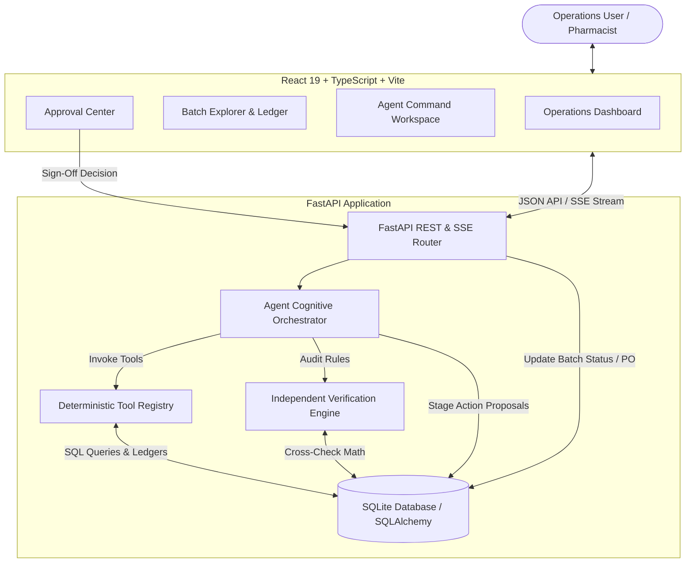

# Arogya AI — Pharmaceutical Inventory Intelligence & Autonomous Operations Agent 🏥💊

An end-to-end agentic decision-support system built for pharmaceutical distributors. Arogya AI investigates batch recalls, traces recipient customers, reconciles physical quantities, detects cold-chain thermal breaches, audits expiring stocks against supplier return windows, executes independent deterministic verifications, and stages consequential actions at human-in-the-loop approval gates.

---

## 1. Project Overview

Arogya AI is a full-stack, hackathon-ready operations command center designed for pharmaceutical distributors handling high-consequence inventory (antibiotics, biologicals, critical care injectables). Rather than acting as a generic conversational chatbot or fabricated animation, the platform uses a 7-stage cognitive loop backed by a normalized SQLite database, deterministic application tools, and human approval gates.

---

## 2. Problem Statement & Intended Users

### Problem
Traditional ERP and WMS platforms show aggregate inventory numbers but struggle with critical operations questions:
- *A regulatory recall notice arrived for antibiotic Batch B2231 — which exact chemists and hospitals received it, in what quantities, and over what dates?*
- *Can eligible alternative Batch B2240 cover both replacement obligations and normal forecast demand, or will acute hospital wards face stockouts?*
- *Did a cold-chain storage excursion in Unit 2 compromise protein integrity, requiring immediate quarantine?*
- *Which batches approaching expiry can still be returned for full vendor credit before the supplier return window closes?*

### Intended Users
- **Responsible Pharmacists & Quality Assurance (QA) Officers**: Verify trace records and regulatory notices before issuing dispatch freezes or customer advisories.
- **Supply Chain & Operations Directors**: Review stock allocation proposals, supplier lead times, and purchase-order commitments.
- **Warehouse Managers**: Oversee bin-level physical stock segregation and quarantine tagging.

> **Safety Boundary Notice**: Arogya AI is an operational decision-support system. It does not independently determine clinical medicine safety or make autonomous regulatory rulings.

---

## 3. Features Implemented in the Demo

- **Operations Dashboard**: Real-time KPI metrics (Tracked Products, Batches, Active Recalls, Cold-Chain Exceptions, Pending Approvals) and prioritized "What needs attention today?" exception feed directly queried from SQLite.
- **Inventory & Batch Explorer**: Live catalog filtering by batch number, brand, molecule, warehouse, and status. Detailed inspection modal displaying chronological stock movement ledgers and customer outward dispatches.
- **Autonomous Operations Agent**:
  - **7-Stage Cognitive Loop**: Intake &rarr; Planning &rarr; Tool Execution &rarr; Analysis &rarr; Deterministic Verification &rarr; Approval Gate &rarr; Reporting.
  - **Core Batch B2231 Recall Scenario**:
    - Traces 640 outward units across 25 distinct customers (2 hospitals, 23 chemists).
    - Distinguishes 180 remaining physical units in Central Depot Bin C-14.
    - Evaluates alternative Batch B2240 (400 units) against replacement demand (640) and normal demand (210), discovering a 440-unit net deficit.
    - Compares Option 1 (Hospital-first allocation + 600-unit emergency PO) vs Option 2 (Pro-rata allocation).
  - **Independent Deterministic Verification**: Independent arithmetic checks verifying `sum(dispatches) == 640`, recipient count == 25, allocation bounds &le; 400, and supplier MOQ compliance &ge; 500.
- **Compliance & Approval Center**:
  - Interactive governance dashboard holding proposed consequential actions (`dispatch_hold`, `customer_notice`, `purchase_order`, `stock_allocation`).
  - Role-based sign-off modal (Lead Pharmacist, QA Compliance Officer, Operations Director).
  - Approving a dispatch freeze immediately updates the database batch status to `dispatch_hold`.
- **Database Reset & Heuristic Demo Mode**: Zero paid API tokens required; instant pristine reset via `POST /api/demo/reset`.

---

## 4. Features Explicitly Not Implemented (Future Work)

- **Direct ERP/WMS Protocol Integrations**: Live SAP or Oracle NetSuite EDI integrations (simulated internally).
- **Physical External Transmissions**: Real SMS/Email gateway broadcasts to pharmacies or real EDI purchasing orders.
- **Clinical Pharmacology Assays**: Direct biochemical validation of medicine potency after temperature excursions (requires laboratory testing).
- **Multi-Tenant SSO & Cryptographic Audit Signing**: Production OAuth2/OIDC role enforcement and tamper-proof ledger hashing.

---

## 5. System Architecture



---

## 6. Directory Structure

```
agentic-hackathon/
├── backend/
│   ├── app/
│   │   ├── agent/
│   │   │   ├── __init__.py
│   │   │   └── orchestrator.py      # 7-stage cognitive loop & event logging
│   │   ├── routers/
│   │   │   ├── __init__.py
│   │   │   ├── agent.py             # POST /api/agent/run, GET /api/agent/stream/{id}
│   │   │   ├── approvals.py         # GET /api/approvals, POST /api/approvals/{id}/action
│   │   │   ├── dashboard.py         # GET /api/dashboard/summary
│   │   │   ├── demo.py              # POST /api/demo/reset
│   │   │   ├── health.py            # GET /api/health
│   │   │   ├── inventory.py         # GET /api/inventory/batches, products
│   │   │   └── workflow.py          # Backward-compatibility routes
│   │   ├── tools/
│   │   │   ├── __init__.py
│   │   │   └── registry.py          # Deterministic tools & verification checks
│   │   ├── config.py                # Environment and CORS configuration
│   │   ├── database.py              # SQLAlchemy engine & SQLite thread-safe session
│   │   ├── db_models.py             # Normalized ORM schemas
│   │   ├── main.py                  # FastAPI lifespan & middleware entry point
│   │   ├── schemas.py               # Pydantic v2 validation models
│   │   └── seed.py                  # Synthetic seed data for Batch B2231, B2240, etc.
│   ├── tests/
│   │   ├── __init__.py
│   │   ├── test_arogya.py           # 8 comprehensive Arogya AI domain tests
│   │   ├── test_health.py           # Health endpoint tests
│   │   └── test_workflow.py         # Workflow validation tests
│   ├── .env.example
│   ├── pytest.ini
│   └── requirements.txt
├── frontend/
│   ├── src/
│   │   ├── components/
│   │   │   ├── AgentWorkspaceView.tsx   # Scenario picker, live events, verification, report
│   │   │   ├── ApprovalCenterView.tsx   # Action proposals, role sign-off modal
│   │   │   ├── BatchExplorer.tsx        # Searchable inventory table & detail ledger modal
│   │   │   ├── Header.tsx               # Branding, live status badge, reset button
│   │   │   └── OperationsDashboard.tsx  # Metrics cards & prioritized attention feed
│   │   ├── services/
│   │   │   └── api.ts                   # Typed API client for FastAPI endpoints
│   │   ├── types/
│   │   │   ├── arogya.ts                # TypeScript interfaces for inventory & agent
│   │   │   └── workflow.ts              # Compatibility types
│   │   ├── App.css                      # Warm off-white & terracotta styles
│   │   ├── App.tsx                      # Top-level view router & state controller
│   │   ├── index.css                    # Design tokens & resets
│   │   └── main.tsx                     # React 19 root
│   ├── package.json
│   ├── tsconfig.json
│   └── vite.config.ts                   # Proxy configuration for /api
└── README.md
```

---

## 7. Frontend Architecture

The frontend is built with **React 19**, **TypeScript**, and **Vite**.

- **Design System**: Warm off-white canvas (`#FAF8F5`), terracotta / rust-red accent (`#C05638`), charcoal typography (`#1E242B`), and subtle border contours (`#E5DFD5`).
- **State Management**:
  - `App.tsx` coordinates top-level tab state (`dashboard`, `inventory`, `agent`, `approvals`).
  - `OperationsDashboard` passes clicked attention action prompts straight to the `AgentWorkspaceView` and executes them seamlessly.
  - `ApprovalCenterView` provides a role-based modal for Pharmacists or QA Officers, posting approved decisions back to FastAPI and updating badge counters.
- **Communication**: All API requests are dispatched via [frontend/src/services/api.ts](file:///home/phoolghobhi/agentic-hackathon/frontend/src/services/api.ts), routed through Vite's local proxy to `http://127.0.0.1:8000`.

---

## 8. Backend Architecture & Request Lifecycle

1. **Intake & Validation**: Pydantic v2 schemas in [schemas.py](file:///home/phoolghobhi/agentic-hackathon/backend/app/schemas.py) strictly validate inputs.
2. **Database Session**: Injected via FastAPI's `Depends(get_db)` using SQLAlchemy with a thread-safe connection pool and 30-second timeout.
3. **Execution**:
   - The user triggers `POST /api/agent/run` with a task prompt.
   - [orchestrator.py](file:///home/phoolghobhi/agentic-hackathon/backend/app/agent/orchestrator.py) creates an `AgentRun` record, decomposes the task into sequential steps, and invokes functions in [registry.py](file:///home/phoolghobhi/agentic-hackathon/backend/app/tools/registry.py).
   - Each tool execution writes an `AgentEvent` record to the database.
4. **Verification**: [ToolRegistry.verify_incident_report](file:///home/phoolghobhi/agentic-hackathon/backend/app/tools/registry.py#L295) cross-checks math and database constraints independently.
5. **Approval Staging**: Proposals are written to `action_proposals` in `pending_review` status.

---

## 9. Database Schema & Relationships

- **Product**: `id`, `sku`, `name`, `molecule`, `brand`, `category`, `storage_range`, `is_critical`, `unit_price`, `min_safety_stock`.
- **Warehouse**: `id`, `code`, `name`, `location`, `cold_storage_available`.
- **BatchInventory**: `id`, `batch_number`, `product_id`, `warehouse_id`, `available_quantity`, `initial_quantity`, `manufacturing_date`, `expiry_date`, `status` (`active`, `quarantine`, `dispatch_hold`, `recalled`).
- **StockMovement**: `id`, `batch_id`, `movement_type`, `quantity`, `reference_doc`, `timestamp`, `notes`.
- **Customer**: `id`, `code`, `name`, `customer_type` (`chemist`, `hospital`), `contact_email`, `phone`, `license_number`.
- **Dispatch**: `id`, `dispatch_number`, `customer_id`, `batch_id`, `product_id`, `quantity`, `dispatch_date`, `status`.
- **Supplier**: `id`, `name`, `lead_time_days`, `min_order_quantity`, `return_window_days`.
- **PurchaseOrder**: `id`, `po_number`, `supplier_id`, `product_id`, `quantity`, `status`, `urgency`.
- **TemperatureLog**: `id`, `warehouse_id`, `cold_room_unit`, `recorded_at`, `temperature_celsius`, `is_excursion`, `duration_minutes`.
- **AgentRun**: `id`, `prompt`, `state`, `plan_json`, `evidence_json`, `verification_json`, `final_report_json`.
- **AgentEvent**: `id`, `run_id`, `step_number`, `stage`, `event_type`, `tool_name`, `message`, `data_json`.
- **ActionProposal**: `id`, `run_id`, `action_type`, `title`, `description`, `rationale`, `target_entity`, `status`, `approved_by`.
- **ApprovalDecision**: `id`, `proposal_id`, `decision`, `approver_role`, `approver_name`, `notes`, `timestamp`.

---

## 10. The Batch B2231 Recall Walkthrough

1. **Trigger**: User starts `"Investigate recall Batch B2231."`
2. **Tool 1 (`get_inventory_by_batch`)**: Retrieves Batch B2231. 180 units remain physically in Central Depot Bin C-14.
3. **Tool 2 (`get_batch_movements`)**: Audits stock movements. Verifies 1000 initial units receipt &rarr; 640 outward dispatches &rarr; 180 units balance on hand.
4. **Tool 3 (`trace_batch_recipients`)**: Traces all 25 outward customer dispatches:
   - 2 Hospitals (Apollo City Hospital: 85 units, St. Jude Memorial Hospital: 65 units &rarr; Total 150 units).
   - 23 Retail Chemists across municipal wards &rarr; Total 490 units.
   - Dispatched sum: $150 + 490 = 640$ units.
5. **Tool 4 (`calculate_replacement_availability`)**: Inspects eligible alternative Batch B2240 (400 units). Total demand = 640 (replacement) + 210 (14-day normal demand forecast) = 850 units. Net shortfall = 440 units.
6. **Tool 5 (`compare_response_options`)**:
   - *Option 1 (Recommended)*: Guarantee 100% replacement to the 2 hospitals (150 units); allocate 250 units to priority retail chemists; issue emergency Purchase Order for 600 units to Cipla Direct (MOQ 500) under expedited 7-day courier delivery.
   - *Option 2*: Pro-rata distribution (62.5% to everyone). Rejected as acute hospital inpatient wards would suffer immediate shortages.
7. **Verification**: 5 independent tests pass (Dispatched sum == 640, Recipient count == 25, Warehouse separation established, Allocation &le; 400, PO &ge; 500 MOQ).
8. **Human Approval Gate**: Staged 4 proposals (`dispatch_hold`, `customer_notice`, `purchase_order`, `stock_allocation`).
9. **Execution**: The user clicks **"Sign-Off & Execute"** on the dispatch hold as Lead Pharmacist. Batch B2231 transitions to `dispatch_hold` in the database.

---

## 11. Prerequisites & Quick Start

### Prerequisites
- **Python**: 3.10+ (tested on Python 3.14)
- **Node.js**: 18+
- **SQLite3**: Built-in

### Terminal 1: Backend
```bash
cd backend
source .venv/bin/activate
pip install -r requirements.txt
uvicorn app.main:app --reload --host 0.0.0.0 --port 8000
```
* API Root: [http://localhost:8000](http://localhost:8000)
* Swagger UI Docs: [http://localhost:8000/docs](http://localhost:8000/docs)
* Health Check: [http://localhost:8000/api/health](http://localhost:8000/api/health)

### Terminal 2: Frontend
```bash
cd frontend
npm install
npm run dev
```
* Operations Console: [http://localhost:5173](http://localhost:5173)

---

## 12. Running Automated Tests

Run the backend pytest suite:
```bash
cd backend
.venv/bin/pytest -v
```

All 13 tests verify:
- Exact 640-unit batch reconciliation and 25-recipient customer trace.
- Replacement demand, normal demand, and shortfall calculations.
- Expiry date burn rate and 60-day supplier return window eligibility.
- Cold-chain temperature excursion detection (&gt;8°C).
- Deterministic verification failure traps (rejects falsified counts or over-allocations).
- End-to-end agent workflow state progression.
- Human approval gate and consequential database state updates.
- API endpoints for health, dashboard, inventory, and agent execution.

---

## 13. API Endpoint Reference

| Method | Endpoint | Description |
|---|---|---|
| `GET` | `/api/health` | Service status, semantic version, and available stages |
| `GET` | `/api/dashboard/summary` | Live metrics, active alerts, and prioritized attention list |
| `GET` | `/api/inventory/batches` | List batches with search, status, and warehouse filters |
| `GET` | `/api/inventory/batches/{batch}` | Detailed dossier with movement ledger and outward dispatches |
| `GET` | `/api/inventory/products` | Catalog listing with storage specifications and safety thresholds |
| `GET` | `/api/agent/templates` | Pre-configured task templates |
| `POST` | `/api/agent/run` | Execute operations agent on custom or templated problem prompt |
| `GET` | `/api/agent/stream/{run_id}` | Real-time Server-Sent Events (SSE) log stream |
| `GET` | `/api/approvals` | List action proposals filtered by status |
| `POST` | `/api/approvals/{id}/action` | Submit authorized sign-off (approve/reject) with audit metadata |
| `POST` | `/api/demo/reset` | Reset and re-seed database to clean baseline |

---

## 14. Future Post-Hackathon Roadmap

### Phase 1 — Immediate Hardening
- **PostgreSQL Migration**: Replace SQLite with PostgreSQL for high-concurrency transactions.
- **Authentication & RBAC**: Real OAuth2/JWT authentication with cryptographic signatures for pharmacist approvals.

### Phase 2 — Distributed Reliability & Integrations
- **Celery / Redis Job Queue**: Move long-running multi-batch scans to durable background worker queues.
- **ERP & EDI Integrations**: Connect directly to SAP S/4HANA or GS1 DataMatrix barcode scanning for physical lot tracking.
- **Direct Supplier API Gateways**: Automate purchase order submissions to verified distributor EDI endpoints.

### Phase 3 — Advanced Predictive Intelligence
- **Seasonal Demand Forecasting**: Machine learning models predicting antibiotic demand surges during monsoon/winter seasons.
- **Dynamic Multi-Warehouse Re-balancing**: Optimization algorithms generating transfer orders between regional logistics hubs to minimize expiry waste.
